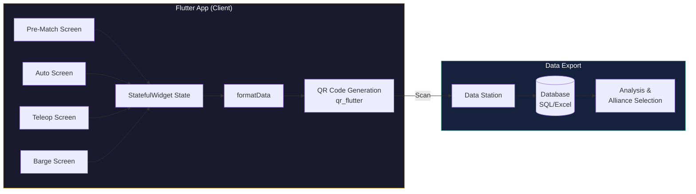

# FRC Reefscape Match Scouting App (2025)

> A cross-platform Flutter app for real-time FRC match scouting at competition—capture game data on any device, export via QR codes for instant database import.

[](https://flutter.dev)
[](https://dart.dev)
[](https://www.thebluealliance.com/team/1730)
[]()

---

## About

In my senior year (2025), I wanted to take [Team 1730 (Team Driven)](https://www.thebluealliance.com/team/1730)'s scouting system to a more professional level. The previous Java/Android apps worked, but I needed **cross-platform compatibility** so any team member could scout from any device—phone, tablet, or laptop. I rewrote the match scouting app in **Dart/Flutter** and structured the QR payload for easy **database import**, enabling SQL-based queries for alliance selection and strategy analysis.

This is the final-year rewrite that powered our 2025 Reefscape season scouting.

**[Project Site](https://aamir-frc-scouting.github.io)** · **[Organization](https://github.com/aamir-frc-scouting)**

---

## Screenshots

<table>
  <tr>
    <td align="center"><br/><b>Pre-Match</b></td>
    <td align="center"><br/><b>Autonomous</b></td>
    <td align="center"><br/><b>Teleop</b></td>
  </tr>
  <tr>
    <td align="center"><br/><b>Endgame (Barge)</b></td>
    <td align="center"><br/><b>QR Export</b></td>
    <td></td>
  </tr>
</table>

---

## Features

- **5-Tab Workflow**: Pre-match setup → Autonomous → Teleop → Endgame → QR Export
- **Visual Field Selection**: Interactive field diagram for starting position; reef placement diagram for scoring locations
- **Real-Time Counters**: Track coral placements (L4/L3/L2/Trough), algae handling (processor/net), and missed cycles
- **Status Tracking**: Robot issues (died/broke), defense played/faced, climb level (none/park/shallow/deep)
- **Instant QR Export**: One tap generates a scannable QR code with all 24 data fields
- **Cross-Platform**: Runs on Android, iOS, web, and desktop from a single codebase
- **Offline-First**: No network required during matches—perfect for competition venues
- **Auto-Increment Match**: Automatically advances match number after each submission

---

## 2025 Season Stats

This app captured match data across **3 events** for Team 1730's 2025 Reefscape season:

| Event | Matches | Teams | Robot Scouts | Data Points |
|-------|---------|-------|--------------|-------------|
| [Heartland Regional](https://www.thebluealliance.com/event/2025ksla) | 87 | 36 | 522 | 12,528 |
| [Greater Kansas City Regional](https://www.thebluealliance.com/event/2025mokc) | 81 | 36 | 486 | 11,664 |
| [Newton Division (Championship)](https://www.thebluealliance.com/event/2025new) | 140 | 75 | 840 | 20,160 |
| **Total** | **308** | — | **1,848** | **44,352** |

*Formula: Robot scouts = matches × 6 robots per match. Data points = robot scouts × 24 fields per scout.*

---

## Architecture

### Data Flow



### QR Payload Structure (24 Fields)

The QR code contains an asterisk-delimited string with all scouting data:

```
matchNumber*teamNumber*preload*alliancePosition*fieldPosition*leave*
autoReefPlacements*autoCount*died*broke*playedDefense*facedDefense*
coralL4*coralL3*coralL2*coralTrough*algaeProcessor*algaeNet*
algaeTakeOff*missed*bargeLevel*comments*totalCoralCycles*scoutName
```

| Field | Type | Description |
|-------|------|-------------|
| `matchNumber` | int | Match identifier |
| `teamNumber` | int | Robot team number |
| `preload` | Yes/No | Started with game piece |
| `alliancePosition` | string | Red 1-3 or Blue 1-3 |
| `fieldPosition` | string | Starting location (Alliance Wall → Processor Wall) |
| `leave` | Yes/No | Left starting zone in auto |
| `autoReefPlacements` | string | Reef positions + heights (e.g., "A4 - B3 - C2") |
| `autoCount` | int | Number of auto placements |
| `died` | Yes/No | Robot stopped working |
| `broke` | Yes/No | Robot had mechanical issues |
| `playedDefense` | Yes/No | Played defensive strategy |
| `facedDefense` | Yes/No | Was defended against |
| `coralL4` - `coralTrough` | int | Teleop coral placements by level |
| `algaeProcessor` | int | Algae scored in processor |
| `algaeNet` | int | Algae scored in net |
| `algaeTakeOff` | int | Algae removed from reef |
| `missed` | int | Missed scoring attempts |
| `bargeLevel` | enum | Climb level: none/park/shallow/deep |
| `comments` | string | Free-form notes |
| `totalCoralCycles` | int | Computed: L4+L3+L2+Trough |
| `scoutName` | string | Scout identifier |

### Tech Stack

- **Framework**: Flutter 3.5+ / Dart 3.5+
- **QR Generation**: [qr_flutter](https://pub.dev/packages/qr_flutter) v4.0.0
- **State Management**: StatefulWidget (single-screen app)
- **UI**: Material Design 3 with dark theme

---

## Why Flutter + Structured QR Export

| Challenge | Solution |
|-----------|----------|
| **Device fragmentation**: Not everyone has Android | Flutter compiles to Android, iOS, web, and desktop from one codebase |
| **No venue WiFi**: Competition networks are unreliable | QR codes work offline—just point a camera |
| **Analysis flexibility**: Excel macros were fragile | Structured payload imports cleanly into SQL databases for real queries |
| **Maintenance burden**: Two separate Android apps | One Flutter codebase for match scouting + one for pit scouting |

---

## Build & Run

### Prerequisites

- [Flutter SDK](https://docs.flutter.dev/get-started/install) 3.5.0 or later
- For Android: Android SDK and a device/emulator
- For iOS: Xcode and a Mac
- For Web: Chrome
- For Linux: `ninja-build`, `libgtk-3-dev`

### Quick Start

```bash
# Clone the repository
git clone https://github.com/aamir-frc-scouting/frc-scouting-app-2025.git
cd frc-scouting-app-2025

# Get dependencies
flutter pub get

# Run on connected device or emulator
flutter run

# Or run as web app
flutter run -d chrome

# Or build release APK for Android
flutter build apk --release
```

### Verified Build (Ubuntu 24.04)

```bash
# Install Flutter (if not present)
curl -fsSL https://storage.googleapis.com/flutter_infra_release/releases/stable/linux/flutter_linux_3.24.0-stable.tar.xz -o flutter.tar.xz
tar xf flutter.tar.xz
export PATH="$PWD/flutter/bin:$PATH"

# Install Linux desktop dependencies
sudo apt-get install -y ninja-build libgtk-3-dev

# Build and run
cd frc-scouting-app-2025
flutter pub get
flutter build web --release
# Serve the build/web directory with any HTTP server
```

---

## Related Projects

This is part of the [aamir-frc-scouting](https://github.com/aamir-frc-scouting) organization:

- **frc-scouting-app-2025** (this repo) — Match scouting for 2025 Reefscape
- **frc_pit_scouting_app_2025** — Pit scouting companion app
- **frc-scouting-app-2024** — Match scouting for 2024 Crescendo (Java/Android)
- **frc-scouting-app-2023** — Match scouting for 2023 Charged Up (Java/Android)

---

## Author

**Aamir Abatiyow** — FRC Team 1730 (Team Driven), 2023–2025

Built to support data-driven alliance selection and match strategy at FIRST Robotics competitions.

---

*Part of the [aamir-frc-scouting](https://github.com/aamir-frc-scouting) project family.*
