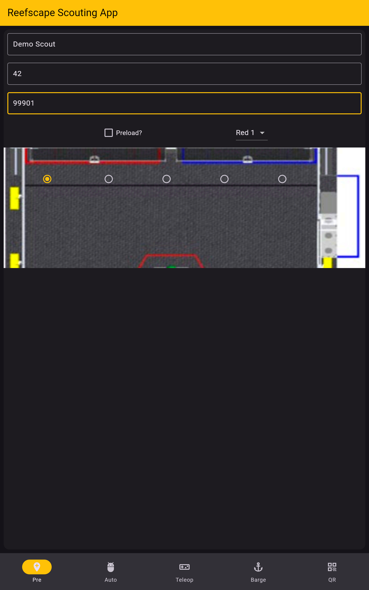
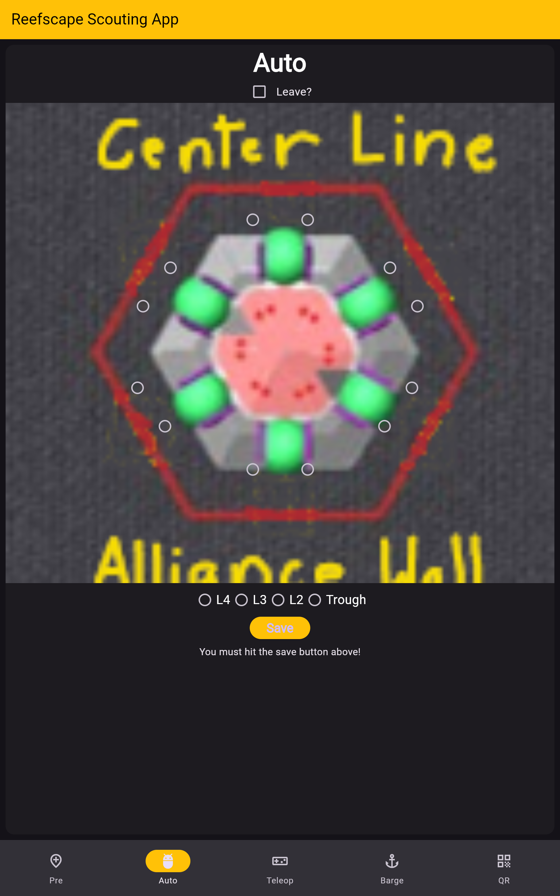
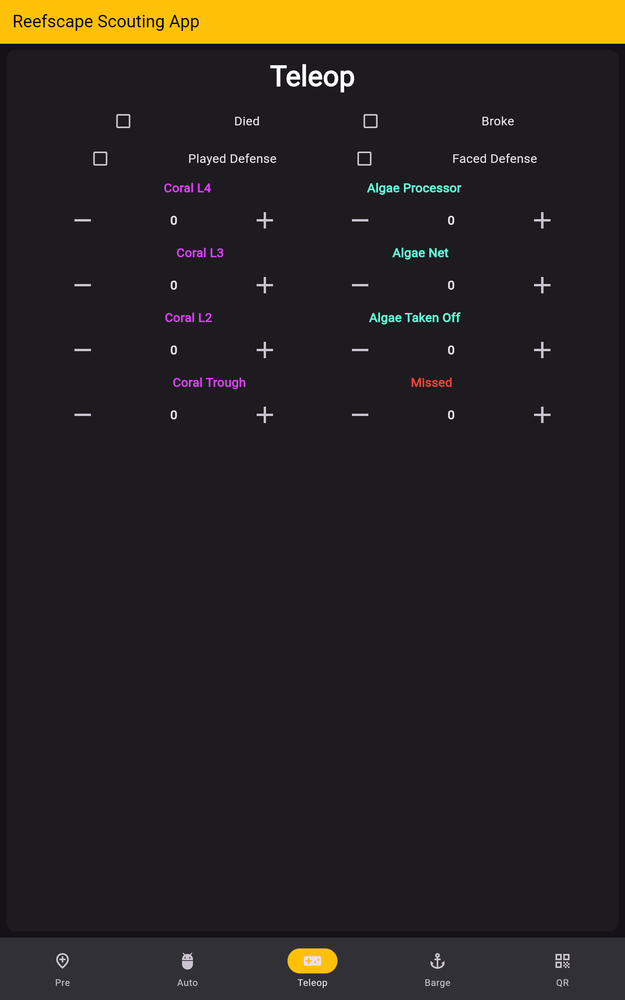
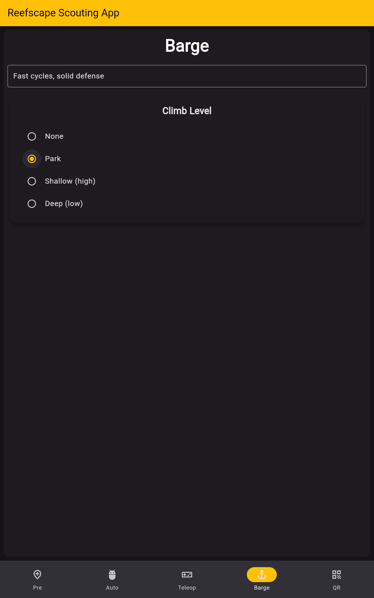
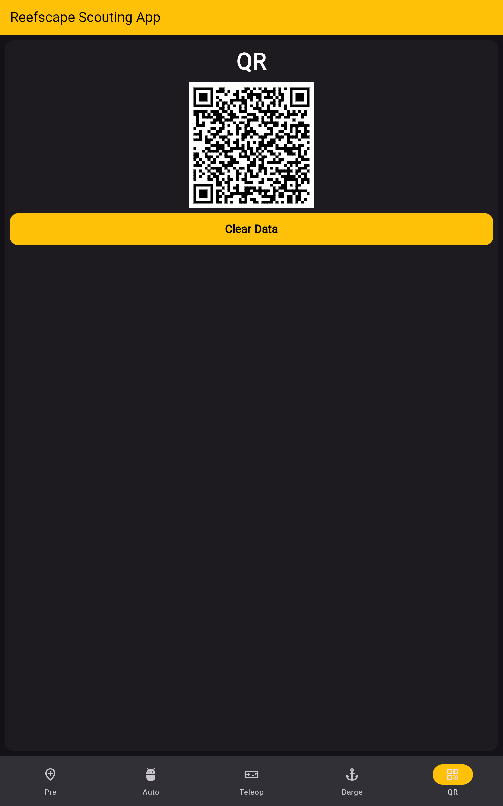
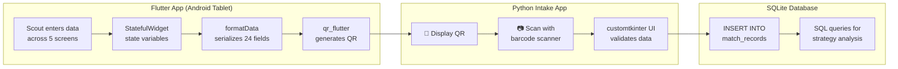

# FRC 2025 Reefscape Match Scouting App

<div align="center">

[](https://developer.android.com/)
[](https://flutter.dev/)
[](https://dart.dev/)
[](https://firstfrc.blob.core.windows.net/frc2025/Manual/2025GameManual.pdf)

**Cross-platform Flutter app that captures match data and encodes it into QR codes for offline scouting at FRC competitions.**

[Features](#features) · [Screenshots](#screenshots) · [Architecture](#architecture) · [Usage Stats](#usage-stats) · [Build](#build-instructions)

</div>

---

## Background

My freshman year on [FRC Team 1730 (Team Driven)](https://www.thebluealliance.com/team/1730/2025), I was a scout lead learning the ropes from seniors Heath Crump and Caden Findlay. That was 2022 Rapid React — the team won the [Newton Division](https://www.thebluealliance.com/event/2022new) and reached [Einstein](https://www.thebluealliance.com/event/2022cmptx). Sophomore year (2023 Charged Up), I took over as solo developer and built my first Android scouting app in Java, exporting QR codes that got scanned into Excel. Junior year (2024 Crescendo), I kept the match app going and added a second app for pit scouting.

Senior year I wanted a more professional setup. I rewrote both apps in Dart/Flutter for cross-platform support — the same codebase runs on Android tablets, iOS, web, and desktop. The apps still generate QR codes, but now they're scanned by a Python/customtkinter intake app that validates and inserts each record into SQLite. Strategy questions became SQL queries instead of VLOOKUP formulas.

— [Aamir Abatiyow](https://github.com/AamirAbatiyow)

## Screenshots

<div align="center">
<table>
  <tr>
    <td align="center"><br/><b>Pre-Match</b></td>
    <td align="center"><br/><b>Autonomous</b></td>
    <td align="center"><br/><b>Teleop</b></td>
  </tr>
  <tr>
    <td align="center"><br/><b>Endgame (Barge)</b></td>
    <td align="center"><br/><b>QR Export</b></td>
    <td></td>
  </tr>
</table>

<sub>Rendered at 10" portrait tablet size, the devices the team scouted on.</sub>
</div>

## Features

- **5-tab workflow**: Pre-match → Autonomous → Teleop → Endgame → QR Export
- **Visual field selection**: Interactive field diagram for starting position; reef placement diagram for auto scoring locations
- **Real-time counters**: Track coral placements (L4/L3/L2/Trough), algae handling (processor/net), and missed cycles
- **Status tracking**: Robot issues (died/broke), defense played/faced, climb level (none/park/shallow/deep)
- **QR code export**: One tap generates a scannable QR code with all 24 data fields
- **Cross-platform**: Single Flutter codebase runs on Android, iOS, web, and desktop
- **Offline-first**: No network required during matches — perfect for competition venues
- **Auto-increment match**: Match number advances automatically after each submission

## Usage Stats

<table>
<tr>
<td>

### Events Scouted

| Event | Matches | Data Points |
|:------|--------:|------------:|
| [Heartland Regional](https://www.thebluealliance.com/event/2025ksla) | 87 | 12,528 |
| [Greater Kansas City Regional](https://www.thebluealliance.com/event/2025mokc) | 81 | 11,664 |
| [Houston Champs — Newton Division](https://www.thebluealliance.com/event/2025new) | 140 | 20,160 |

</td>
<td>

### Season Totals

| Metric | Count |
|:-------|------:|
| Events | 3 |
| Matches | 308 |
| Robot Scouts | 1,848 |
| Fields per Scout | 24 |
| **Total Data Points** | **44,352** |

</td>
</tr>
</table>

<sub>Robot scouts = matches × 6 robots/match. Data points = scouts × 24 fields.</sub>

## Architecture

### Data Flow



### QR Payload Schema (24 Fields)

The QR code contains an asterisk-delimited string:

```
matchNumber*teamNumber*preload*alliancePosition*fieldPosition*leave*
autoReefPlacements*autoCount*died*broke*playedDefense*facedDefense*
coralL4*coralL3*coralL2*coralTrough*algaeProcessor*algaeNet*
algaeTakeOff*missed*bargeLevel*comments*totalCoralCycles*scoutName
```

| Field | Type | Description |
|-------|------|-------------|
| `matchNumber` | int | Match identifier |
| `teamNumber` | int | Scouted robot's team number |
| `preload` | Yes/No | Started with game piece |
| `alliancePosition` | string | Red 1-3 or Blue 1-3 |
| `fieldPosition` | string | Starting location on field |
| `leave` | Yes/No | Left starting zone in auto |
| `autoReefPlacements` | string | Reef positions + heights (e.g., "A4 - B3") |
| `autoCount` | int | Number of auto coral placements |
| `died` | Yes/No | Robot stopped working |
| `broke` | Yes/No | Mechanical failure |
| `playedDefense` | Yes/No | Played defensive strategy |
| `facedDefense` | Yes/No | Was defended against |
| `coralL4` | int | Teleop L4 coral placements |
| `coralL3` | int | Teleop L3 coral placements |
| `coralL2` | int | Teleop L2 coral placements |
| `coralTrough` | int | Teleop trough coral placements |
| `algaeProcessor` | int | Algae scored in processor |
| `algaeNet` | int | Algae scored in net |
| `algaeTakeOff` | int | Algae removed from reef |
| `missed` | int | Missed scoring attempts |
| `bargeLevel` | enum | Climb: none/park/shallow/deep |
| `comments` | string | Free-form notes |
| `totalCoralCycles` | int | Computed: L4+L3+L2+Trough |
| `scoutName` | string | Scout identifier |

## Build Instructions

### Requirements

- **Flutter SDK** 3.6.0 or later ([install guide](https://docs.flutter.dev/get-started/install))
- For Android: Android SDK with a connected device or emulator
- For web: Chrome browser

### Steps

1. Clone the repository:
   ```bash
   git clone https://github.com/aamir-frc-scouting/frc-scouting-app-2025.git
   cd frc-scouting-app-2025
   ```

2. Install dependencies:
   ```bash
   flutter pub get
   ```

3. Run on a connected device:
   ```bash
   flutter run
   ```

4. Or build a release APK for Android tablets:
   ```bash
   flutter build apk --release
   ```

### Project Structure

```
├── lib/
│   └── main.dart              # Single-file app with all screens
├── assets/
│   └── images/
│       ├── field image.png    # Starting position selector
│       └── reef placement.png # Auto reef placement diagram
├── pubspec.yaml               # Flutter dependencies
└── docs/
    └── screenshots/           # App screenshots for README
```

## What Came Next

### Why Flutter + SQLite?

The Java/Android apps worked, but device fragmentation was a pain — not everyone had Android. Flutter compiles to Android, iOS, web, and desktop from one codebase. The Excel macros were fragile and hard to modify; SQLite lets anyone write queries without touching VBA. The QR transfer stayed because it works offline at venues with unreliable WiFi.

## Tech Stack

| Component | Technology |
|-----------|------------|
| Framework | Flutter 3.6+ / Dart 3.6+ |
| QR Generation | [qr_flutter](https://pub.dev/packages/qr_flutter) 4.0.0 |
| State Management | StatefulWidget |
| UI | Material Design 3, dark theme |
| Intake App | Python 3, customtkinter, SQLite |
| Game Manual | [2025 Reefscape](https://firstfrc.blob.core.windows.net/frc2025/Manual/2025GameManual.pdf) |

## License

This repository does not currently have a license. Please contact the author before using this code in your own projects.

---

<div align="center">

**Part of the [Team 1730 scouting system](https://github.com/aamir-frc-scouting)**

[2023 Match](https://github.com/aamir-frc-scouting/frc-scouting-app-2023) · [2024 Match](https://github.com/aamir-frc-scouting/frc-scouting-app-2024) · [2024 Pit](https://github.com/aamir-frc-scouting/frc-pit-scouting-app-2024) · **2025 Match** · [2025 Pit](https://github.com/aamir-frc-scouting/frc_pit_scouting_app_2025)

</div>
